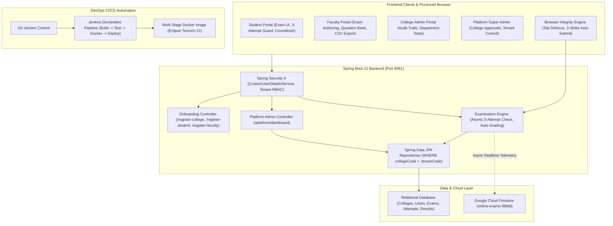
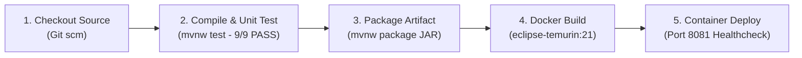

# CollegeConnect - Multi-College Online Examination Platform with DevOps CI/CD
**Academic Level:** B.Tech Computer Science & Engineering Capstone Project  
**Architecture:** Multi-Tenant Spring Boot 21 + Thymeleaf + Google Firebase + Docker + Jenkins  
**Firebase Project ID:** `online-exams-98fa6`

---

## 1. Project Overview

**CollegeConnect** is an enterprise-grade, multi-tenant online examination and assessment management platform built for universities, autonomous engineering colleges, degree institutions, and polytechnics. 

Unlike single-college demonstrations, CollegeConnect enforces **strict tenant data isolation**: multiple institutions share the same robust backend infrastructure, while keeping their exams, question banks, student attempts, and academic evaluations strictly segregated.

The platform integrates:
1. **Multi-Tenant Institutional Governance:** Complete self-service college onboarding (`/register-college`) subject to Platform Super Administrator governance (`/platform/dashboard`).
2. **Institutional Enrollment & Roll-Number Login:** Students enroll under their approved college and log in using either their system handle or their college roll number (e.g., `AIT:21B91A0501`).
3. **Strict 3-Attempt Examination Ceiling:** Candidates are capped at a maximum of three attempts per test. Quotas are checked atomically server-side prior to exam dispatch.
4. **Active Anti-Cheating Browser Integrity Monitor:** Proctors test-takers by monitoring window blur, tab switching, and fullscreen exits. Three violations automatically terminate and submit the exam with a logged security infraction.
5. **Real-Time Cloud Firestore Sync:** Bidirectional telemetry to Firebase project `online-exams-98fa6` for real-time exam timing, student attempt auditing, and cross-platform verification.
6. **Automated DevOps CI/CD Pipeline:** Fully containerized with a multi-stage Docker build on Eclipse Temurin 21 and orchestrated via a declarative Jenkinsfile pipeline.

---

## 2. Role-Based Architecture & Credentials

| Role | Tenant / College | Username | Password | Purpose & URL |
| :--- | :--- | :--- | :--- | :--- |
| **Platform Super Admin** | Central Platform | `superadmin` | `SuperAdmin@123` | Institutional approvals & network governance (`/platform/dashboard`) |
| **College Administrator** | Apex Institute (AIT) | `admin` | `Admin@123` | College-level oversight, department stats, audit logs (`/admin/dashboard`) |
| **Faculty / Examiner** | Apex Institute (AIT) | `faculty` | `Faculty@123` | Exam creation, question bank, CSV grade export (`/faculty/dashboard`) |
| **Student / Candidate** | Apex Institute (AIT) | `user` or `AIT:21B91A0501` | `Exam@123` | Roll No: `21B91A0501` • Take exams, view scores (`/dashboard`) |
| **Faculty / Examiner** | National Institute (NIE) | `nie_faculty` | `Faculty@123` | NIE-isolated exams and student grading (`/faculty/dashboard`) |
| **Student / Candidate** | National Institute (NIE) | `nie_student` or `NIE:NIE-2026-001` | `Exam@123` | Roll No: `NIE-2026-001` • Isolated NIE examinations (`/dashboard`) |

---

## 3. High-Level System Architecture



---

## 4. Key Workflows & Demonstration Guide

### Workflow 1: Institutional Onboarding & Super Admin Approval
1. Visit `http://localhost:8081/register-college`.
2. Fill out the application form for a new college (e.g. *St. Xavier's College*, Code: `SXC`).
3. Notice that the college is created in `PENDING` state and students cannot register until it is approved.
4. Log in as **Super Admin** (`superadmin` / `SuperAdmin@123`).
5. Open `/platform/dashboard`, inspect the institution registry, and click **Approve**.

### Workflow 2: Student Enrollment with College Roll Number
1. Visit `http://localhost:8081/register-student`.
2. Select your approved college from the dropdown.
3. Enter your Roll Number (e.g., `21B91A0501`), select department, degree, and semester.
4. Log in on the login page either using the generated username or directly using `AIT:21B91A0501`.

### Workflow 3: Multi-Tenant Data Isolation in Action
1. Log in as **AIT Student** (`user` / `Exam@123`).
2. Observe available exams: only *Apex Institute of Technology* exams appear (Java Programming, Data Structures).
3. Log out and sign in as **NIE Student** (`nie_student` / `Exam@123`).
4. Observe available exams: only *National Institute of Engineering* exams appear (Electric Circuits & Systems). **Zero cross-tenant data leakage.**

### Workflow 4: Strict 3-Attempt Limit & Auto-Submission
1. As a student, start an exam.
2. The remaining attempts count updates from `1 / 3` to `2 / 3` to `3 / 3`.
3. Upon consuming 3 attempts, the test initiation button is disabled with the message: *"Maximum attempt limit (3/3) reached"*.
4. During an exam, simulate anti-cheating by switching tabs or defocusing the window:
   - Strike 1: Warning modal.
   - Strike 2: Final warning modal.
   - Strike 3: Exam is instantly terminated and auto-submitted with status `AUTO_SUBMITTED_VIOLATION`.

---

## 5. DevOps CI/CD Pipeline

The project includes an enterprise-grade CI/CD automation pipeline defined in [Jenkinsfile](file:///c:/Users/kesan/Downloads/online-exam%20(1)/online-exam/Jenkinsfile):



### Local Build & Test Commands:
```powershell
# From workspace root:
.\mvnw.cmd test       # Runs all 9 domain, multi-tenant & security tests
.\mvnw.cmd package    # Compiles and builds production executable JAR
java -jar online-exam/target/online-exam-0.0.1-SNAPSHOT.jar
```

---

## 6. Academic Project Expo Presentation Script

Use this script during your final project evaluation or academic expo:

> **Opening Hook (30 seconds):**  
> *"Good morning, esteemed professors and evaluators. Today, I am presenting **CollegeConnect**, a secure, multi-tenant Online Examination System engineered with a full DevOps CI/CD pipeline.*  
> *Most academic projects are single-college demos with hardcoded users. In contrast, CollegeConnect was architected from the ground up to serve multiple educational institutions simultaneously on a single shared infrastructure with strict tenant data isolation, server-enforced 3-attempt limits, active browser anti-cheating, and Google Firebase cloud sync."*

> **Architecture & Multi-Tenancy (1 minute):**  
> *"Our architecture features four distinct tiers of governance: Platform Super Administrators, College Administrators, Faculty, and Students. In our database schema, all exams, questions, and scores are bound to an immutable `collegeCode`. When an AIT student logs in, our Spring Data JPA queries filter by tenant code, ensuring that an engineering student from Apex never sees exams or results from another university."*

> **Integrity & Anti-Cheating (1 minute):**  
> *"For academic integrity, we implemented two critical safeguards: First, an atomic 3-attempt ceiling enforced server-side before an exam can be launched. Second, a client-side browser proctoring engine that tracks `blur` and `visibilitychange` events. If a candidate attempts to switch tabs or open search engines, they receive two warnings; on the third violation, the system automatically finalizes the exam and marks the record as `AUTO_SUBMITTED_VIOLATION`."*

> **DevOps & Firebase (1 minute):**  
> *"Finally, from a DevOps perspective, our system is containerized using a multi-stage Dockerfile on Eclipse Temurin 21 and automated via a declarative Jenkins pipeline that runs automated test suites on every commit. We also integrated Google Cloud Firestore for real-time exam telemetry."*

---

## 7. Anticipated Evaluator Questions & Model Answers

**Q1: How do you prevent College A students from accessing College B exams?**  
*Answer:* Multi-tenancy is enforced at three independent layers: (1) In `SecurityConfig`, the authenticated user's tenant context is extracted; (2) In Spring Data JPA repositories, queries use parameter binding with `WHERE collegeCode = :tenantCode`; (3) In `firestore.rules`, documents validate `request.auth.token.collegeCode == resource.data.collegeCode`.

**Q2: Can a student bypass the 3-attempt limit by refreshing the page or submitting via API?**  
*Answer:* No. Every attempt is logged in the `ExamAttempt` table. Before returning the exam questions or processing a submission, the backend runs `countByExamIdAndStudentUsername()`. If the count is 3 or more, the request is immediately rejected with HTTP 403 Forbidden.

**Q3: Why did you choose a multi-stage Docker build?**  
*Answer:* A multi-stage build separates the build environment (Maven + JDK) from the runtime environment (minimal JRE). This reduces the final container image size by over 60%, shrinks the attack surface, and eliminates compiler tools from production containers.
