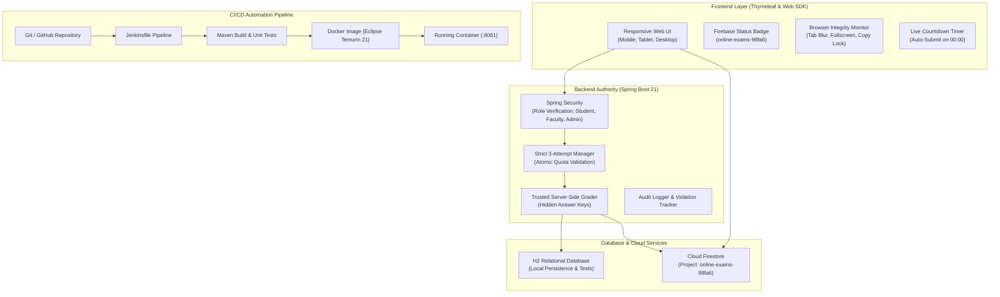

# College Online Examination System with DevOps CI/CD
**Institution:** Apex Institute of Technology  
**Department:** Computer Science & Engineering  
**Capstone DevOps Project:** Online Exam System with Strict Attempt Quotas & Browser Integrity Monitoring  
**Firebase Project ID:** `online-exams-98fa6`

---

## 1. Project Overview

The **College Online Examination System** is a responsive, secure, enterprise-grade academic testing platform designed for colleges. It provides dedicated role-based portals for **Students**, **Faculty**, and **College Administrators**, with built-in enforcement of a **strict 3-attempt ceiling**, real-time **anti-cheating browser integrity monitoring**, **Cloud Firestore** synchronization, and an end-to-end **Jenkins & Docker CI/CD DevOps pipeline**.

---

## 2. Core Features

### 🎓 Student Module
* **Secure Authentication:** Role-based login and session protection.
* **Available Examinations:** Subject-wise exam list displaying remaining attempt quotas (`X / 3`).
* **Attempt Quota Enforcement:** Displays *"You have used all three attempts for this examination"* and disables further test initialization once 3 attempts are reached.
* **Examination Screen:**
  * Live countdown timer with automatic submission on expiration.
  * Interactive question palette (answered items indicated in green).
  * Answered and remaining question counter.
* **Integrity Monitoring:**
  * Detects tab switching, window defocusing, and exiting fullscreen.
  * Configurable warnings (Violation 1 and Violation 2).
  * **Automatic exam submission** upon Violation 3.
* **Results & Performance:** Historical results breakdown with scores, percentages, and attempt logs.

### 👨‍🏫 Faculty Module
* **Exam Management:** Create exams, set duration, subjects, and attempt quotas.
* **Question Bank Management:** Add 4-option multiple-choice questions with answer keys and marks.
* **Student Performance Dashboard:** Filter results by subject or student ID.
* **CSV Result Export:** Instant download of class performance data (`college-exam-results.csv`).
* **Security Audit Trail:** Inspect violation logs and submission types.

### 🏛️ College Administrator Module
* **Institutional Governance:** Overview of college metrics, enrolled students, and faculty.
* **Department Oversight:** Multi-department and branch configuration.
* **Attempt Audit Logs:** Complete audit log of every student attempt.
* **Quota Reset:** Authorized mechanism to reset attempts upon formal student appeal.

### 🔥 Cloud Firebase Integration
* **Project ID:** `online-exams-98fa6`
* **Real-time Status Pill:** Visual indicator in navigation header (`🟢 Firebase: online-exams-98fa6`).
* **Cloud Firestore Sync:** Real-time synchronization of student attempts, final scores, and integrity violations.
* **Strict Security Rules:** `firestore.rules` enforces college data isolation and prevents students from altering scores or quotas.

---

## 3. Demo Credentials

| Role | Username | Password | Dashboard URL |
| :--- | :--- | :--- | :--- |
| **Student** | `user` | `Exam@123` | `http://localhost:8081/dashboard` |
| **Faculty** | `faculty` | `Faculty@123` | `http://localhost:8081/faculty/dashboard` |
| **College Admin** | `admin` | `Admin@123` | `http://localhost:8081/admin/dashboard` |

---

## 4. Architecture Diagram



---

## 5. Technology Stack

* **Programming Language:** Java 21 (Eclipse Temurin JDK)
* **Backend Framework:** Spring Boot, Spring MVC, Spring Data JPA, Spring Security
* **Frontend:** Thymeleaf 3, HTML5, CSS3, JavaScript (ES6+), Firebase Web SDK
* **Database:** Cloud Firestore (`online-exams-98fa6`) & H2 In-Memory Database
* **Build Tool:** Apache Maven 3.9+ (with `mvnw` wrapper)
* **Testing:** JUnit 5, Mockito
* **DevOps & Containers:** Docker (Multi-stage build), Jenkins Declarative Pipeline, Git

---

## 6. How to Run Locally

### Prerequisites
* Java 21 JDK installed
* Git installed
* Docker (optional for containerization)

### Step 1: Clone and Navigate
```bash
git clone https://github.com/kesanikrishnakarthik/Online-Exam-System.git
cd Online-Exam-System
```

### Step 2: Build and Run Automated Tests
```powershell
.\mvnw.cmd test
```
All 6 domain and security tests will run and pass.

### Step 3: Run the Application
```powershell
.\mvnw.cmd spring-boot:run
```

### Step 4: Open in Browser
Open [http://localhost:8081](http://localhost:8081) in your browser.
Log in using any of the demo accounts listed above.

---

## 7. Docker Deployment

### Build the Docker Image
```bash
docker build -t online-exam:1.0 .
```

### Run the Container
```bash
docker run -d --name online-exam-container -p 8081:8081 online-exam:1.0
```

### Inspect Container Logs
```bash
docker logs -f online-exam-container
```

---

## 8. Jenkins CI/CD Pipeline

The included `Jenkinsfile` runs the following automated pipeline:
1. **Checkout from GitHub:** Checks out the latest branch.
2. **Environment Verification:** Verifies Java 21, Maven, and Docker versions.
3. **Run Automated Tests:** Executes all unit and security tests (`mvn test`).
4. **Publish Test Reports:** Publishes JUnit XML test results.
5. **Build Application:** Compiles the Spring Boot fat JAR.
6. **Build Docker Image:** Builds the `online-exam:1.0` multi-stage container.
7. **Deploy Application:** Stops old containers and starts the updated image on port 8081.
8. **Health Check:** Confirms container availability.

---

## 9. Comprehensive Documentation Sitemap

* [ARCHITECTURE.md](file:///c:/Users/kesan/Downloads/online-exam%20(1)/online-exam/ARCHITECTURE.md) - Deep architectural and security design.
* [FIREBASE_SETUP.md](file:///c:/Users/kesan/Downloads/online-exam%20(1)/online-exam/FIREBASE_SETUP.md) - Firebase Console setup and Firestore activation.
* [DATABASE_SCHEMA.md](file:///c:/Users/kesan/Downloads/online-exam%20(1)/online-exam/DATABASE_SCHEMA.md) - Relational and Firestore collections schema.
* [SECURITY.md](file:///c:/Users/kesan/Downloads/online-exam%20(1)/online-exam/SECURITY.md) - Strict attempt quota rules and browser integrity specifications.
* [DEVOPS_PIPELINE.md](file:///c:/Users/kesan/Downloads/online-exam%20(1)/online-exam/DEVOPS_PIPELINE.md) - Complete Jenkins and Docker deployment guide.
* [TESTING_GUIDE.md](file:///c:/Users/kesan/Downloads/online-exam%20(1)/online-exam/TESTING_GUIDE.md) - Manual and automated testing checklist.

